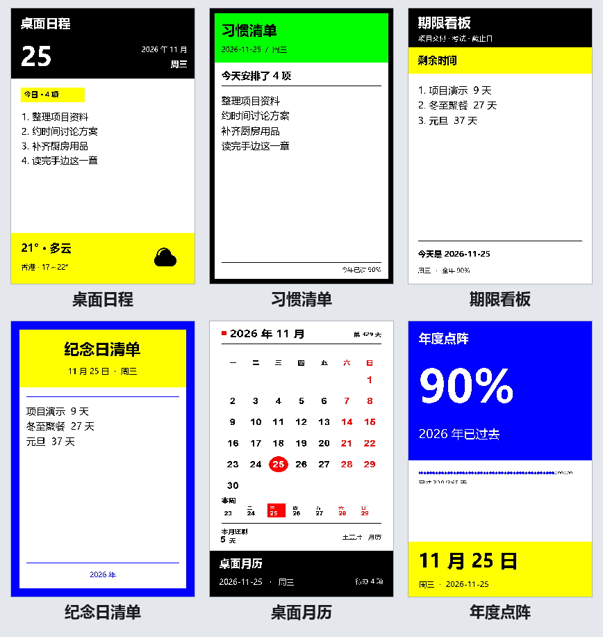
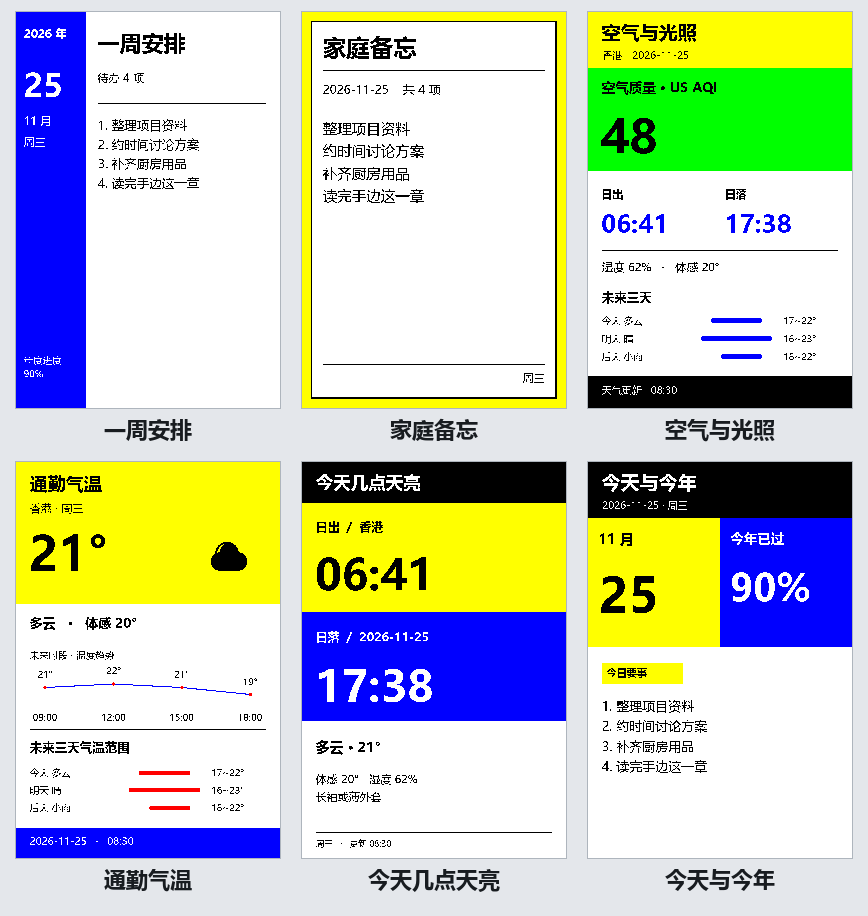
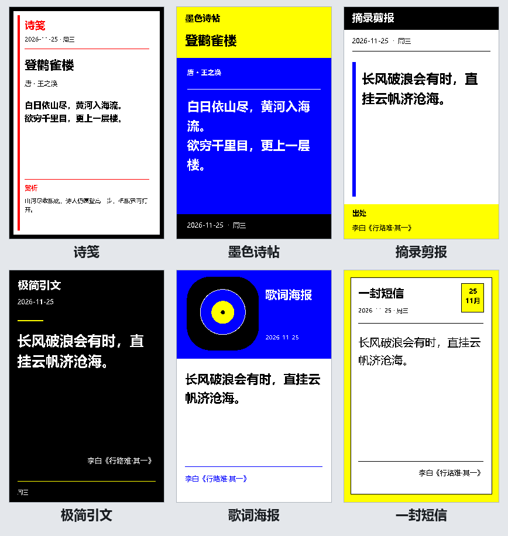

# 六色场景版式

包含动态日期与现有内容的预览使用示例数据。每份 JSON 只覆盖一个卡片类型。打开文件页，复制地址到「看板版式包 → 从 GitHub 导入」，也可以用文件页的下载按钮保存 JSON。查看预览后，点「应用版式」才会替换当前卡面。

待办、倒计时、天气、诗词和每日一句继续读取应用里已有的内容。英语短语、成语、开发者笔记、历史、问题卡和名片自带可替换的示例文字。要更换这些正文，修改 JSON 中对应的 `text` 再导入。

## 联网看板

添加后可从卡片侧栏打开。Android 1.8.13 起，汇率速览、假日倒数、一周地震和剧集档案会在打开、手动刷新和计划推送时拉取 GitHub 最新版。历史一页需要 Android 1.8.11 或更新版本。

| 版式文件 | 联网内容 |
|---|---|
| [汇率速览](live-rates.json) | 美元对人民币、港币、欧元和日元，显示参考汇率日期 |
| [假日倒数](live-holidays.json) | 中国香港公众假期和最近一个假期的倒数 |
| [一周地震](live-earthquake.json) | 美国地质调查局近一周最新重要地震，显示震级、时间和深度 |
| [剧集档案](live-television.json) | 每日轮换，包含剧集首播日期、平台、状态、评分及简介 |

新增自动更新的官方场景时，在本目录发布 `live-名称.json`，并在上表添加一行。文件沿用单模板的 `schemaVersion: 1` 格式。外部接口的结果由发布端写入 JSON，应用在打开场景或执行计划时下载并渲染。已发布场景应保留原文件名和模板类型，这样已添加的卡片和计划可以继续更新。上述四张卡由 GitHub Actions 每两小时检查数据。
| [历史一页](online-history-note.json) | 按当天日期联网查询历史事件，可切换条目 |
| [晨间简报](online-daily-brief.json) | 联网天气、每日一句、待办和年度进度 |
| [通勤气温](online-commute-forecast.json) | 当地气温、小时趋势和未来三天预报 |
| [空气与光照](online-air-sun-dashboard.json) | 空气质量、日出日落、湿度和三天预报 |
| [今天几点天亮](online-day-night.json) | 当地日出和日落 |
| [出门天气](online-weather-field.json) | 小时趋势、三天预报、湿度和日出日落 |
| [天气色卡](online-weather-tiles.json) | 满版色块、空气质量和穿衣参考 |
| [蓝色天气看板](online-weather-blue-weather.json) | 蓝底气温、天气图标和预报 |
| [蓝色天气色卡](online-weather-blue-weather2.json) | 蓝色主题的色块天气 |
| [桌面日程](online-desk-agenda.json) | 当天日期、待办和当地天气 |
| [一句＋天气](online-quote-weather.json) | 每日一句与当前天气 |
| [极简引文](online-minimal-quote.json) | 黑底大字与实际署名 |
| [摘录剪报](online-reading-clipping.json) | 每日一句正文和出处 |
| [歌词海报](online-lyric-poster.json) | 海报版式，可填歌词，也可使用每日一句 |
| [一封短信](online-letter-note.json) | 便笺版式，读取每日一句和署名 |
| [诗笺](online-poetry-folio.json) | 联网诗词、作者和赏析 |
| [墨色诗帖](online-ink-poem.json) | 联网诗词，采用黄底题签和蓝底正文 |
| [诗词日签](online-verse-almanac.json) | 结合日期展示每日诗词 |

## 计划与日期

| 版式文件 | 应用到 | 内容 |
|---|---|---|
| [桌面日程](desk-agenda.json) | 每日总结 | 日期、待办和出门天气 |
| [习惯清单](habit-checklist.json) | 今日待办 | 读取自己的待办，版式可切换编号 |
| [期限看板](deadline-board.json) | 倒计时 | 项目、考试或交付日的剩余天数 |
| [纪念日清单](anniversary-list.json) | 倒计时 | 生日、假期和纪念日 |
| [桌面月历](monthly-desk-calendar.json) | 月历 | 实时月历和当天待办数 |
| [年度点阵](year-dot-grid.json) | 时间进度 | 全年比例、点阵和今日日期 |

## 日常信息

| 版式文件 | 应用到 | 内容 |
|---|---|---|
| [一周安排](weekly-overview.json) | 今日待办 | 适合把一周要事录入待办，再按编号查看 |
| [家庭备忘](household-memo.json) | 今日待办 | 把采购、家务和提醒集中在一张卡 |
| [空气与光照](air-sun-dashboard.json) | 色块天气 | AQI、日出日落、湿度和三天预报 |
| [通勤气温](commute-forecast.json) | 天气看板 | 大字气温、小时曲线和三天范围 |
| [今天几点天亮](day-night.json) | 色块天气 | 把当地日出和日落放大 |
| [今天与今年](milestone.json) | 时间进度 | 今天日期、全年进度和当天待办 |

## 阅读与表达

| 版式文件 | 应用到 | 内容 |
|---|---|---|
| [诗笺](poetry-folio.json) | 每日诗词 | 接入诗词标题、作者、原诗与现有赏析 |
| [墨色诗帖](ink-poem.json) | 每日诗词 | 黄底题签和蓝底正文，留出长诗版面 |
| [摘录剪报](reading-clipping.json) | 每日一句 | 正文与原出处，适合编辑每日一句作为自己的摘录 |
| [极简引文](minimal-quote.json) | 每日一句 | 黑底大字与署名，适合短句 |
| [歌词海报](lyric-poster.json) | 每日一句 | 把自己有权使用的歌词或句子填入每日一句 |
| [一封短信](letter-note.json) | 每日一句 | 使用一句话和署名字段写便笺或问候 |

## 学习与创作

| 版式文件 | 应用到 | 内容 |
|---|---|---|
| [英语短语](english-phrase.json) | 自定义卡片 | 自带短语、释义、例句和搭配的示例 |
| [成语笔记](idiom-notebook.json) | 自定义卡片 | 收录成语读音、释义和例句，可替换词条 |
| [开发者笔记](developer-note.json) | 自定义卡片 | 包含一条可实用的 Git 技巧，命令与解释可编辑 |
| [历史一页](history-note.json) | 自定义卡片 | 用事件时间、正文和追问组织一页历史 |
| [问题卡](question-card.json) | 自定义卡片 | 在桌边展示一个复盘或学习问题 |
| [桌面名片](profile-card.json) | 自定义卡片 | 姓名、角色和联络方式为可替换示例 |

## 先前发布的七套

| 版式文件 | 内容 |
|---|---|
| [晨间简报](../daily-brief.json) | 天气、待办、年度进度和引文 |
| [出门天气](../weather-field.json) | 小时曲线、三天预报、湿度和日出日落 |
| [天气色卡](../weather-tiles.json) | 满版色块、AQI 和穿衣参考 |
| [专注清单](../focus-list.json) | 大字待办和年度进度 |
| [诗词日历](../verse-almanac.json) | 诗词日签和年度进度 |
| [蓝色天气](../weather-blue.json) | 两张蓝色主题天气卡 |
| [一句＋天气](../quote-weather.json) | 引文与当前天气 |

场景设计参考了阅星晖的清单、日期、阅读、学习和名片等用途，版式和示例文字为土豆片六色屏重新设计。 [Xteink 场景广场](https://www.xteink.cn/app/scene-market)
